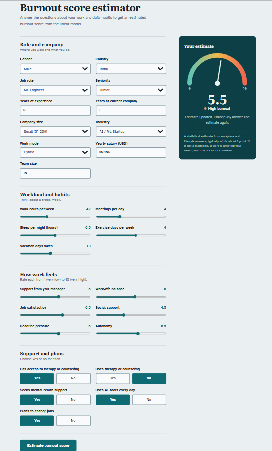

# Mental Health Burnout Score

Estimate an employee's burnout score from 27 answers about their job, workload, habits and support. A scikit-learn linear regression pipeline is served by a FastAPI backend, with a single-page web form and gauge on top.

> This is a statistical estimate, not a diagnosis or medical advice.



## What it does

- Takes 27 inputs (role, company, workload, lifestyle, how work feels, support and plans).
- Returns a predicted `burnout_score` rounded to two decimals.
- Shows the result on a gauge at `/ui`, with interactive API docs at `/docs`.

## Model results

Target: `burnout_score`. Split: 80/20, `random_state=42`. Scores are R² on the test set unless noted.

| Experiment | Test R² | Test MAE |
|---|---|---|
| All features including `burnout_level` (target leakage) | 0.941 | 0.514 |
| Without `burnout_level` | 0.880 | 0.742 |
| Also without `stress_score` | 0.820 | 0.911 |
| Also without `phq9_score`, `gad7_score` | 0.796 | 0.970 |
| Also without `phq9_category`, `gad7_category` (final) | **0.723** | **1.130** |

The final model uses only workplace and lifestyle features, so it explains what contributes to burnout instead of reading symptoms or a copy of the target. Five-fold cross-validation scores: Linear 0.723, Ridge 0.723, tuned Random Forest 0.640. The linear model was kept. See [CASE_STUDY.md](CASE_STUDY.md) for the full story.

## Project structure

```
Mental Health Burnout Score/
  main.py                      FastAPI app (API, validation, serves the UI)
  index.html                   Web form and gauge
  Mental_Health_Burnout.pkl    Trained scikit-learn pipeline
  requirements.txt             Python dependencies
  README.md
  CASE_STUDY.md
  notebook.ipynb               EDA, preprocessing and training (rename to match yours)
```

## Setup (Windows)

Requires Python 3.12.

```
cd "C:\VS Code\App\Mental Health Burnout Score"
python -m venv venv
venv\Scripts\activate
pip install -r requirements.txt
```

## Run

```
python -m uvicorn main:app --reload
```

Then open:

- http://127.0.0.1:8000/ui for the web form
- http://127.0.0.1:8000/docs for the interactive API docs

Stop the server with Ctrl+C.

## API

`POST /predict` takes JSON and returns `{"predicted_mental_health_burnout_score": <float>}`.

Save this as `sample.json`:

```json
{
  "gender": "Female", "country": "India", "job_role": "Data Scientist",
  "seniority_level": "Mid", "years_experience": 5, "years_at_company": 2,
  "company_size": "Mid (201-1000)", "industry": "Fintech", "work_mode": "Hybrid",
  "salary_usd": 90000, "work_hours_per_week": 45, "meetings_per_day": 3,
  "team_size": 8, "sleep_hours_per_night": 7, "exercise_days_per_week": 3,
  "vacation_days_taken": 10, "therapy_access": 1, "uses_therapy": 0,
  "ai_tools_daily": 1, "manager_support_score": 6, "work_life_balance_score": 5,
  "job_satisfaction_score": 6, "social_support_score": 6,
  "deadline_pressure_score": 6, "autonomy_score": 6,
  "seeks_mental_health_support": 0, "job_change_intention": 0
}
```

Then call it:

```
curl.exe -X POST http://127.0.0.1:8000/predict -H "Content-Type: application/json" -d @sample.json
```

Inputs are validated with Pydantic. Values outside the allowed ranges or lists return a 422 error that names the field. The allowed ranges and categories are defined in `PersonData` in `main.py`.

## How the model was built

1. **Preprocessing** (`ColumnTransformer`): skewed numeric columns get median imputation, `log1p` and scaling; other numeric columns get median imputation and scaling; ordinal columns (company size, seniority) use an ordered `OrdinalEncoder`; nominal columns (gender, country, job role, industry, work mode) use one-hot encoding.
2. **Model**: `LinearRegression` in a single scikit-learn `Pipeline`, so the API sends raw column values and the pipeline does the rest.
3. **Columns removed on purpose**: `burnout_level` (a binned copy of the target), `stress_score`, `phq9_score`, `gad7_score`, `phq9_category`, `gad7_category` (symptoms of burnout, not drivers of it) and `age` (0.97 correlated with `years_experience`).

## Limitations

- R² of about 0.72 means roughly 28% of the variation is not explained. Typical error is about 1 point (MAE 1.13).
- The model finds associations in the training data, not proven causes.
- Data: source not documented. The dataset has 100,000 rows and 27 features plus the burnout score. Its origin (real survey or synthetic) is unknown, so the results are a demonstration of the method, not evidence about real workers.
- The `.pkl` file only loads reliably with scikit-learn 1.9.1, the version it was saved with.
- `allow_origins=["*"]` in `main.py` is fine for local use. Restrict it before deploying publicly.

## Tech stack

Python 3.12, pandas, scikit-learn, FastAPI, Pydantic v2, Uvicorn, vanilla HTML/CSS/JavaScript.

## Author

Manish Bandra. [LinkedIn](https://www.linkedin.com/in/m%C3%A0%C3%B1%C3%ACsh-b%C3%A0%C3%B1dr%C3%A0-b66535401)

## License

MIT. See [LICENSE](LICENSE).
